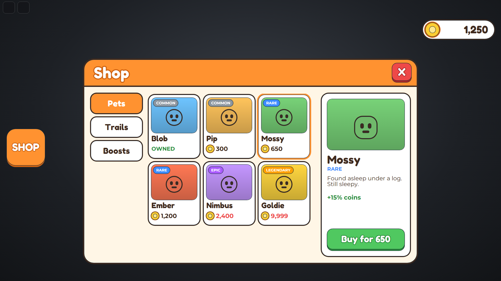
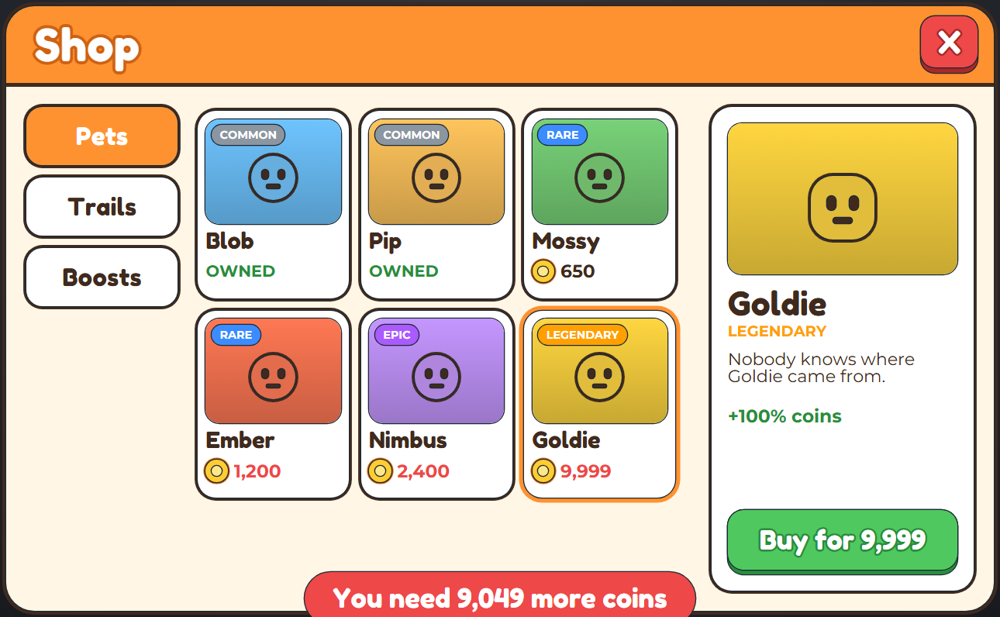
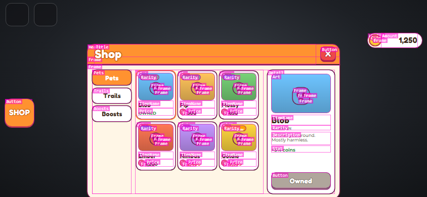
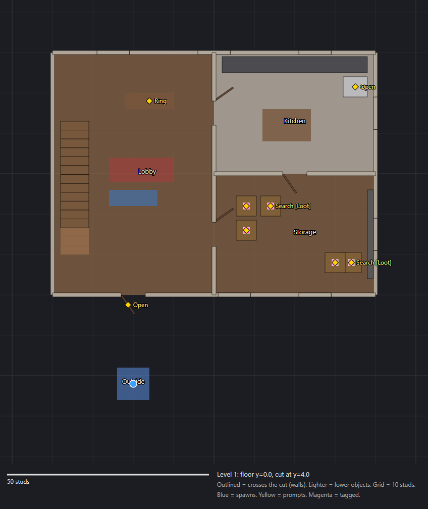
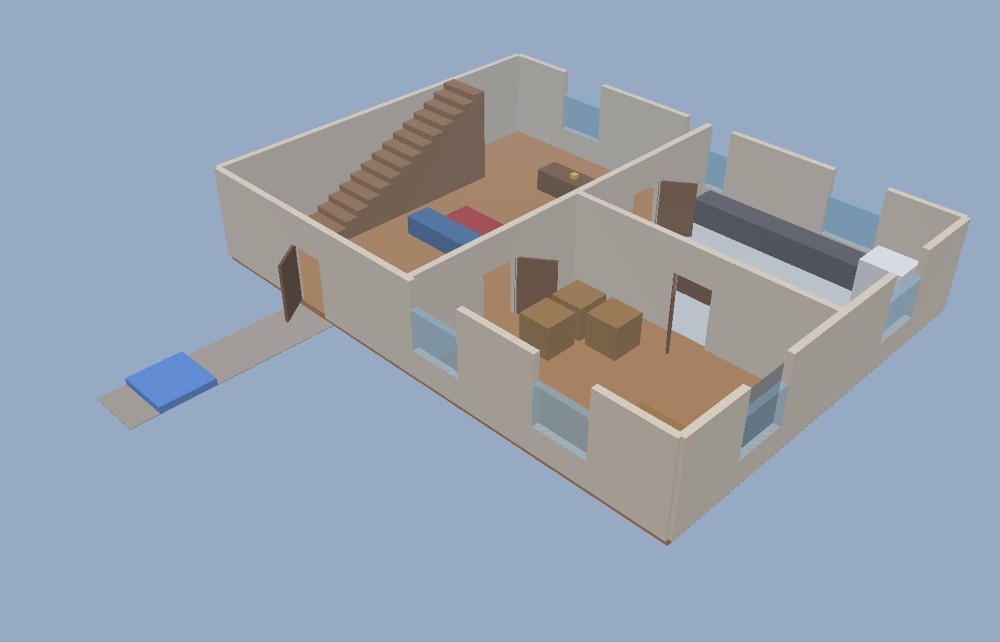

# roblox-offline-render

See your Roblox UI and maps without opening Studio.

Two command-line tools, written in Luau and run with [Lune](https://github.com/lune-org/lune):

- **uikit** runs your game's real client scripts (and its server scripts, if you want) and screenshots
  the UI they build. Click buttons, type in boxes, fire remotes, and take a picture at any screen size.
- **mapview** turns a `.rbxm` or `.rbxl` file into floor plans, 3D views and a summary of what's in it.

They were made for AI coding agents. An agent writing Roblox code can't see Studio, so it can't tell
whether the shop it just wrote overflows on a phone or whether the house it generated has a door into
the kitchen. With these, it renders the result, reads the picture and fixes what's wrong. They work just
as well from your own terminal or in CI.

> **Right now** uikit needs a [Rojo](https://rojo.space) project (your scripts as files on disk).
> **Next:** working straight from a saved place file, and handing the finished UI back as one file to
> drag into Studio, so you can do the work offline and bring it in at once.

<p align="center">
  
</p>

That screen was rendered by this scenario, from the example project's real `LocalScript`:

```lua
return {
	run = function(ui)
		ui.boot({ server = true })                 -- the server script runs too, in loopback
		ui.click("ShopGui/ShopButton/Button")
		ui.click("ShopGui/Window/Grid/mossy")
		ui.shot("pets")
	end,
}
```

## Quick start

You need [Lune](https://github.com/lune-org/lune) 0.10 (`rokit install` in this folder), Roblox Studio
installed (uikit reads its fonts), and Chrome or Edge (for PNGs).

```bash
git clone https://github.com/NKachi2U/roblox-offline-render
cd roblox-offline-render
rokit install

# UI: the example shop
cd examples/shop
lune run ../../uikit/run.luau shop-open        # -> examples/shop/artifacts/uikit/*.png
lune run ../../uikit/run.luau buy-item         # buys something through the real server script
cd ../..

# Maps: the example house
lune run mapview/run.luau examples/maps/SampleHouse.rbxm --tags Loot   # -> artifacts/mapview/*.png
```

For your own game, run uikit from your Rojo project's folder and point it at a scenario:

```bash
lune run path/to/roblox-offline-render/uikit/run.luau my-scenario      # ./ui-scenarios/my-scenario.luau
lune run path/to/roblox-offline-render/mapview/run.luau MyMap.rbxm
```

## uikit

<p>
  
  
</p>

- Runs your Rojo project's scripts: LocalScripts, ModuleScripts, and optionally server Scripts, with
  RemoteEvents and RemoteFunctions looped back between them and DataStores kept in memory.
- Lays the UI out the way Roblox does (scale and offset, UIListLayout, UIGridLayout, AutomaticSize,
  scrolling canvases, constraints, UIScale, text wrapping with the real Roblox fonts) and paints it with
  corners, strokes and gradients.
- Scenarios click, hover, type and press keys, then take shots, crop to an element, outline every box,
  or print the GUI tree with exact pixel rectangles. They can `assert` on what the UI shows, so a run
  can fail like a test.
- Stand in for the server with `ui.remote(path, fn)` when your server code can't run offline.

It doesn't draw 3D: ViewportFrames show as a hatched box, and `rbxassetid://` images are hatched unless
you drop the image file in. Full docs: [uikit/README.md](uikit/README.md).

## mapview

<p>
  
  
</p>

- Finds the building's floors on its own and draws a plan of each one: walls outlined, furniture, a
  10-stud grid to measure doorways with, room names from your Models, spawns, ProximityPrompts with
  their action text, and any CollectionService tags you ask for.
- Renders 3D views from outside and of each floor with the ones above lifted off.
- Writes a text summary: bounds, levels, each group's size and position, prompts, spawns, tags.
- Reads models and places (`.rbxm`, `.rbxmx`, `.rbxl`, `.rbxlx`); `--path Workspace.Map` picks one part
  of a place.

MeshParts and unions are drawn as their bounding boxes, and Terrain isn't drawn. Full docs:
[mapview/README.md](mapview/README.md).

## With Claude Code

This repo is a Claude Code plugin with two skills, `render-roblox-ui` and `view-roblox-map`, that tell
Claude how to use the tools on your project:

```
/plugin marketplace add NKachi2U/roblox-offline-render
/plugin install roblox-offline-render@nkachi2u
```

Then ask for UI or map work as usual; Claude renders the result and checks it. Other agents can use the
tools the same way: the instructions in [skills/](skills/) are plain Markdown.

## Repo layout

```
uikit/       UI renderer
mapview/     map renderer
examples/
  shop/      a small Rojo project (shop menu + server script) with scenarios in ui-scenarios/
  maps/      build-sample.luau, which writes SampleHouse.rbxm
skills/      Claude Code skills
```

## License

MIT
